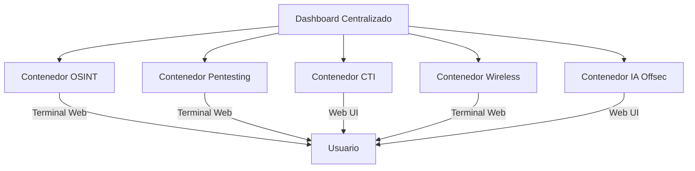

---

## 5. Guía para crear un ecosistema integrado OrcSOC

### Objetivo
Construir una plataforma profesional, modular y escalable que integre todas las herramientas y servicios de OrcSOC, facilitando la operación, automatización y gestión centralizada de ciberseguridad ofensiva y OSINT.

### Pasos recomendados

1. **Diseño de arquitectura modular**
  - Agrupa herramientas por finalidad en contenedores independientes (OSINT, Pentesting, CTI, Wireless, IA, Dashboard).
  - Usa Docker Compose para orquestar servicios y redes internas.

2. **Implementación de dashboard centralizado**
  - Instala un panel web (ej. Dashy, Homer, o propio en Flask/Node) para acceso único a todas las herramientas y terminales web.
  - Configura tarjetas/enlaces directos a cada servicio y terminal.

3. **Integración segura entre servicios**
  - Define redes Docker privadas para comunicación interna.
  - Usa variables de entorno para credenciales y API keys.
  - Aplica autenticación y control de acceso en los paneles y terminales.

4. **Automatización y orquestación**
  - Implementa scripts de arranque, actualización y monitoreo.
  - Considera el uso de APIs para automatizar flujos entre módulos (ej. correlación de IOCs, escaneo automatizado, reportes).

5. **Documentación y soporte**
  - Documenta la instalación, configuración y personalización de cada módulo.
  - Incluye ejemplos de casos de uso y flujos de trabajo típicos.
  - Ofrece canales de soporte y contacto comercial.

### Ejemplo de arquitectura visual



### Recomendaciones comerciales
- Ofrece el ecosistema como producto llave en mano, consultoría o servicio gestionado.
- Personaliza módulos según el cliente (corporativo, MSSP, formación, laboratorio).
- Garantiza cumplimiento legal y ético en el uso de cada herramienta.

---

# Ecosistema OrcSOC

## 1. Clasificación por finalidad de uso

### A. Threat Intelligence / CTI / Reputación
**Herramientas:**
- MISP, OpenCTI
- AlienVault OTX, ThreatFox, Pulsedive
- AbuseIPDB, VirusTotal (free)
- Fav-Up, CloudRip, Interceptor (OSINT técnico de IP/infraestructura)
**Uso:** Correlación de IOCs, reputación de IP/URL, campañas, actores.

### B. OSINT general / Recon web
**Herramientas:**
- UrlChecker, The Time Machine, OnionLand
- Weather2Geo, ClatScope
- Flowsint (investigación visual)
- OSINTMAILER, Masto (Mastodon)
**Uso:** Reconocimiento masivo de URLs, histórico de dominios, darkweb, datos filtrados, redes sociales.

### C. OSINT móvil / apps
**Herramientas:**
- APKHunt, APK URL Grep
**Uso:** Análisis estático de APK, extracción de endpoints y configuración insegura.

### D. Seguridad inalámbrica / IDS
**Herramientas:**
- Kismet IDS
- Wifi-hacking script + buenas prácticas de mitigación
**Uso:** Inventario de AP, detección de redes no autorizadas, pruebas controladas de WPA/WPS.

### E. Web Pentesting (formularios, SQLi, XSS, CMS)
**Herramientas:**
- HBSQLI (SQLi ciega en headers)
- Logsensor (login discovery + SQLi POST)
- XSSGenAI (scanner XSS con IA)
- XAttacker (scanner/exploit CMS)
- RedTeam Scanner v2
- CyberPhish (kits de phishing para concienciación)
**Uso:** Detección de vulnerabilidades típicas OWASP (SQLi/XSS/auth).

### F. OSINT / CTI ofensivo con IA (entornos controlados)
**Herramientas:**
- KawaiiGPT (IA ofensiva open source)
- Drana-Infinity (asistente IA offline para hacking ético)
- DeepEye (scanner IA multi-proveedor)
- BruteForceAI (fuerza bruta asistida por LLM)
**Uso:** Automatizar análisis y pruebas en laboratorios / entornos aprobados.

### G. Plataformas / distros
**Herramientas:**
- BountyOS, Kali, BlackArch, Ubuntu, Kali Nethunter, Termux
**Uso:** Sistemas base para laboratorios, no tanto “una herramienta” en sí.

---

## 2. Principios para agrupar herramientas en contenedores

- **Mismo lenguaje / dependencias:** Se pueden agrupar en un solo contenedor.
- **Necesidades especiales (GPU, red en modo host, privilegios):** Mejor contenedor separado.
- **Servicios grandes con su propia BD (MISP, OpenCTI):** Contenedores propios.

### Ejemplos de agrupación

#### Contenedor 1 – osint-tools
Base: python:3.12-slim o kalilinux/kali-rolling
Herramientas: UrlChecker, The Time Machine, OSINTMAILER, Weather2Geo, ClatScope, Masto, Fav-Up, CloudRip, Interceptor, APK URL Grep (Go)
Uso: CLIs o scripts Python/Go, acceso desde terminal/web-terminal.

#### Contenedor 2 – web-pentest
Base: Kali/debian+python
Herramientas: HBSQLI, Logsensor, XSSGenAI, XAttacker, RedTeam Scanner, DeepEye
Uso: Auditoría web, API keys de IA por variables de entorno.

#### Contenedor 3 – wireless-lab
Base: kalilinux/kali-rolling
Herramientas: Kismet, WiFi-hacking script, herramientas de captura
Requisitos: network_mode: host, cap_add: [ "NET_ADMIN", "NET_RAW" ]
Uso: Acceso a tarjeta WiFi, contenedor aislado.

#### Contenedor 4 – cti-stack
Orquestación de servicios: misp (imagen oficial), opencti (+ neo4j, elastic, rabbitmq, etc.)
Uso: Integrar docker-compose oficiales como “sub-stack”.

#### Contenedor 5 – ai-offsec
Herramientas: kawaiigpt, drana-infinity, bruteforceai
Uso: Modelos IA, librerías pesadas, GPU, imágenes separadas para evitar conflictos.

#### Contenedor 6 – dashboard-ui (Centro de operaciones)
Herramientas: dashy, homer o similar (dashboard de bookmarks/paneles), panel propio en Flask/Node
Uso: UIs web (MISP, OpenCTI, Flowsint), web terminals para CLI, utilitarios (ttyd, wetty)

---

## 3. Ejemplo de estructura docker-compose.yml (alto nivel)

```yaml
version: "3.9"
services:
  ops-center:
    image: lissy93/dashy
    container_name: ops-center
    volumes:
      - ./config/dashy:/app/public
    ports:
      - "8080:80"
    depends_on:
      - osint-tools
      - web-pentest
      - cti-misp
      - cti-opencti
    networks:
      - socnet
  osint-tools:
    build: ./docker/osint-tools
    container_name: osint-tools
    networks:
      - socnet
  web-pentest:
    build: ./docker/web-pentest
    container_name: web-pentest
    networks:
      - socnet
  wireless-lab:
    build: ./docker/wireless-lab
    container_name: wireless-lab
    network_mode: host
    cap_add:
      - NET_ADMIN
      - NET_RAW
  cti-misp:
    image: misp/misp:latest
    container_name: misp
    networks:
      - socnet
  cti-opencti:
    image: opencti/platform:latest
    container_name: opencti
    networks:
      - socnet
  ai-offsec-kawaii:
    build: ./docker/kawaiigpt
    container_name: kawaii-gpt
    networks:
      - socnet
  ai-offsec-drana:
    build: ./docker/drana-infinity
    container_name: drana
    networks:
      - socnet
networks:
  socnet:
    driver: bridge
```

---

## 4. Integración con la “web central”

El dashboard (ops-center) expone un puerto (ej. 8080). En su configuración puedes crear tarjetas que apunten a:
- http://misp:80
- http://opencti:8080
- http://flowsint:3000
- http://osint-tools-terminal:7681 (ttyd para OSINT)
- http://web-pentest-terminal:7682 (terminal para pentesting web)

Así tienes una experiencia tipo SOC: entras a una sola URL y desde ahí accedes a cada herramienta/terminal.