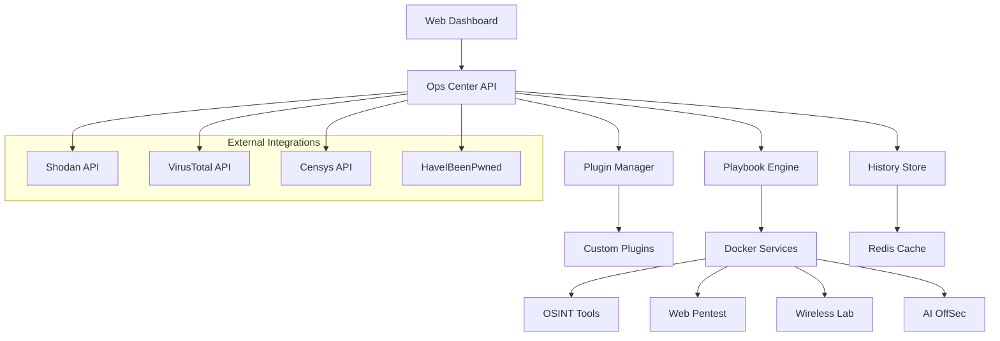

<div align="center">

# 🛡️ OrcSOC Enterprise

**The Ultimate Cybersecurity Operations Platform**

*Centralize • Automate • Analyze • Secure*

[](https://docker.com)
[](https://nodejs.org)
[](https://python.org)
[](https://redis.io)
[](./docs/LICENSE)

[📖 Documentation](./docs/) • [🚀 Quick Start](#-quick-start) • [🔧 Installation](#-installation) • [📊 Dashboard](#-dashboard-features)

---

## 🌟 What is OrcSOC?

OrcSOC Enterprise is a **comprehensive, modular cybersecurity platform** designed for SOC teams, pentesters, red teamers, and security researchers. It provides a unified interface to orchestrate complex security operations, from reconnaissance to exploitation, all within secure, isolated containers.

### 🎯 Key Benefits

- **🔒 Enterprise-Grade Security**: Every tool runs in isolated Docker containers
- **⚡ Full Automation**: Complete security pipelines with AI-powered analysis
- **📊 SOC Dashboard**: Real-time monitoring and threat intelligence
- **🔌 Plugin Architecture**: Extensible system for custom tools and integrations
- **🌐 External APIs**: Seamless integration with Shodan, VirusTotal, Censys, and more
- **📈 Advanced Analytics**: Risk scoring, correlation, and predictive insights

---

## 🏗️ Architecture



### 🐳 Microservices Architecture

| Service | Purpose | Technologies |
|---------|---------|--------------|
| **Ops Center** | Main web interface & API | Node.js, Express, Socket.IO |
| **OSINT Tools** | Intelligence gathering | Python, Subfinder, Amass, theHarvester |
| **Web Pentest** | Web application testing | Nmap, Nikto, SQLMap, WPScan |
| **Wireless Lab** | Wireless security testing | Kismet, Aircrack-ng |
| **AI OffSec** | AI-powered analysis | Ollama, Llama3.2 |
| **Redis** | Caching & job queues | Redis |

---

## 🚀 Quick Start

### Prerequisites
- **Docker & Docker Compose**
- **8GB+ RAM** (16GB recommended)
- **20GB+ free disk space**
- **Linux/macOS** (Windows via WSL2)

### One-Command Installation

```bash
# Clone the repository
git clone https://github.com/felipeibarra/OrcSOC.git
cd OrcSOC

# Run complete installation
./install.sh
```

That's it! 🎉 OrcSOC will be running at **http://localhost:3000**

---

## 📊 Dashboard Features

### 🎛️ SOC Operations Center
- **Real-time Monitoring**: Live progress indicators and status updates
- **Threat Intelligence**: Integrated feeds and correlation engine
- **Risk Assessment**: Automated scoring and prioritization
- **Investigation History**: Persistent storage with replay functionality

### 🔍 Security Operations

#### Full Pipeline Automation
Execute complete security assessments with a single click:
1. **OSINT** → Domain enumeration & intelligence gathering
2. **Recon** → Subdomain discovery & DNS analysis
3. **Ports** → Service detection & version fingerprinting
4. **Vulns** → Vulnerability scanning & exploitation testing

#### Advanced Playbooks
```json
{
  "full-pipeline": {
    "description": "Complete security assessment",
    "steps": [
      {"service": "osint-tools", "command": "enrich domain"},
      {"service": "osint-tools", "command": "enumerate subdomains"},
      {"service": "web-pentest", "command": "port scan"},
      {"service": "web-pentest", "command": "vulnerability scan"}
    ]
  }
}
```

### 🤖 AI-Powered Analysis
- **Intelligent Correlation**: Connect findings across multiple sources
- **Risk Prioritization**: ML-based threat scoring
- **Automated Reporting**: Generate comprehensive security reports
- **Predictive Insights**: Identify potential attack vectors

### 📈 Analytics & Visualization

#### Interactive Charts
- Port distribution analysis
- Vulnerability severity trends
- OSINT relationship mapping
- Risk score distributions

#### Real-time Dashboards
- Current investigation status
- System resource monitoring
- Threat intelligence feeds
- Performance metrics

---

## 🔧 Installation

### Complete Setup
```bash
# Automated installation (recommended)
./install.sh

# Manual installation
docker-compose up --build -d
```

### Configuration
Create a `.env` file for API keys and customization:

```bash
# External API Keys (enhance functionality)
SHODAN_API_KEY=your_shodan_key
VIRUSTOTAL_API_KEY=your_vt_key
CENSYS_API_ID=your_censys_id
CENSYS_API_SECRET=your_censys_secret

# AI Configuration
OLLAMA_MODEL=llama3.2

# Security Settings
STEALTH_MODE=true
STEALTH_DELAY=5000
```

### Helper Scripts
```bash
./start.sh      # Start OrcSOC
./stop.sh       # Stop OrcSOC
./restart.sh    # Restart services
./logs.sh <service>  # View service logs
./update.sh     # Update to latest version
./cleanup.sh    # Complete removal
```

---

## 🔌 Plugin System

### Extend OrcSOC with Custom Tools

```javascript
// Example plugin: advanced-subdomain-enum.js
module.exports = {
  name: 'advanced-subdomain-enum',
  version: '1.0.0',
  description: 'Multi-source subdomain enumeration',
  capabilities: ['recon'],

  async execute(target, options = {}) {
    // Your custom logic here
    return {
      target,
      findings: [...],
      risk_score: 7,
      metadata: {...}
    };
  }
};
```

### Plugin Capabilities
- 🔍 **Recon**: Information gathering and enumeration
- 🧠 **Analysis**: Data correlation and intelligence
- 📋 **Reporting**: Custom report generation
- 🌐 **Integration**: External API connections

---

## 🌐 External Integrations

### Threat Intelligence APIs
- **Shodan**: IoT device discovery and service enumeration
- **VirusTotal**: Malware analysis and URL scanning
- **Censys**: Certificate and infrastructure intelligence
- **HaveIBeenPwned**: Data breach verification

### Webhook Support
Send results to external systems:
```javascript
// Automatic webhook notifications
{
  "event": "scan_complete",
  "target": "example.com",
  "findings": [...],
  "risk_score": 8
}
```

---

## 📚 Documentation

Comprehensive documentation is available in the [`./docs/`](./docs/) directory:

- [📖 **User Guide**](./docs/GUIA_USO_DASHBOARD.md) - Complete usage instructions
- [🔧 **API Reference**](./docs/ENDPOINTS.md) - REST API documentation
- [⚙️ **Configuration**](./docs/INFRAESTRUCTURA.md) - System configuration
- [🔌 **Plugin Development**](./docs/PLUGIN_DEVELOPMENT_GUIDE.md) - Create custom plugins
- [🚨 **Troubleshooting**](./docs/TROUBLESHOOTING.md) - Common issues and solutions
- [📋 **Test Plan**](./docs/TEST_PLAN.md) - Testing procedures

---

## 🎯 Use Cases

### 🔴 Red Team Operations
- Automated reconnaissance campaigns
- Vulnerability chaining and exploitation
- Command & control infrastructure setup
- Anti-forensic testing

### 🛡️ SOC & Incident Response
- Threat hunting automation
- Indicator correlation
- Automated alerting and escalation
- Forensic data collection

### 🔍 Security Research
- OSINT investigations
- Vulnerability research
- Threat intelligence gathering
- Academic security studies

### 🏢 Enterprise Security
- Continuous security assessments
- Compliance monitoring
- Risk management
- Security training environments

---

## 🔒 Security Features

### Container Isolation
- Every tool runs in its own container
- Network segmentation between services
- Resource limits and security profiles

### Stealth Operations
- Configurable delays between operations
- Randomized user agents and timing
- Proxy support for external communications

### Audit & Compliance
- Complete command logging
- User activity tracking
- Exportable audit trails
- GDPR-compliant data handling

---

## 🤝 Contributing

We welcome contributions! Please see our [Contributing Guide](./docs/CONTRIBUTING.md) for details.

### Development Setup
```bash
# Clone and setup
git clone https://github.com/felipeibarra/OrcSOC.git
cd OrcSOC

# Install development dependencies
npm install

# Start development environment
docker-compose -f docker-compose.dev.yml up
```

### Plugin Development
Create custom security tools and share them with the community!

---

## 📄 License

This project is licensed under the MIT License - see the [LICENSE](./docs/LICENSE) file for details.

---

## 🙏 Acknowledgments

- **Security Community**: For the amazing open-source tools
- **Docker Community**: For containerization excellence
- **AI Research**: For advancing cybersecurity automation

---

<div align="center">

**Ready to revolutionize your cybersecurity operations?**

[🚀 **Get Started**](#-quick-start) • [📖 **Documentation**](./docs/) • [🐛 **Report Issues**](https://github.com/felipeibarra/OrcSOC/issues)

---

*Built with ❤️ for the cybersecurity community*

</div>